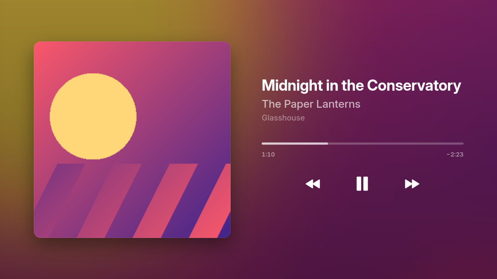
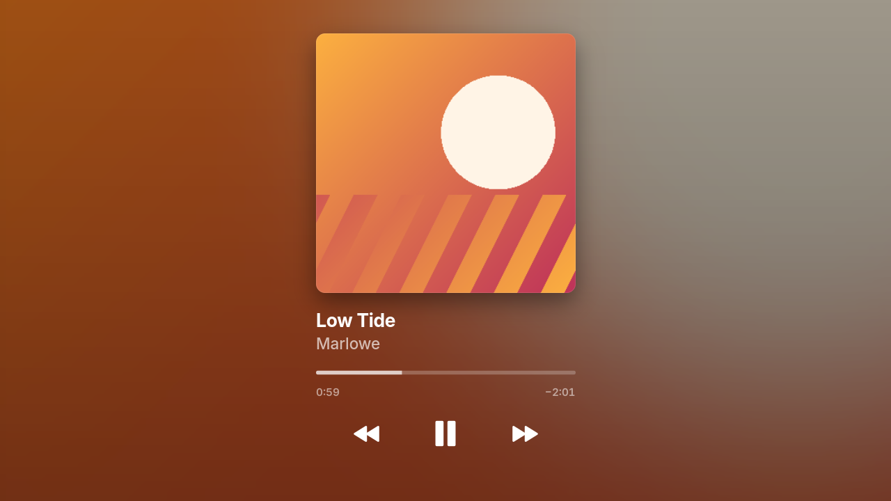

# pi-panel-app-music

A now-playing screen for [pi-panel](https://github.com/mattlokes/pi-panel-core),
styled after Apple Music: the cover over its own blurred colours, the title
and artist, a progress line you can drag, and play/pause and skip buttons.

It follows one player, from either of two sources:

- **Music Assistant**, directly
- **Home Assistant**: any `media_player` entity

| `layout = "side"` | `layout = "stacked"` |
|---|---|
|  |  |

## Install

On the panel:

```bash
sudo apt install gir1.2-gtk-4.0          # GTK 4's Python bindings
pi-panel-pkg install https://github.com/mattlokes/pi-panel-app-music.git
$EDITOR ~/.config/pi-panel/apps/music/config.toml
chmod 600 ~/.config/pi-panel/apps/music/config.toml      # it holds a token
pi-panel-ctl enable music
```

## Configuration

`config.toml` picks one backend and fills in its section; the other section
is ignored. [`config.toml.example`](config.toml.example) documents every key.

**Music Assistant**

```toml
backend = "music_assistant"

[music_assistant]
url = "http://mass.home.local:8095"
token = "…"
player = "Kitchen"
```

- `token`: a long-lived token from Music Assistant's settings (Profile). Servers older than 2.7 need none.
- `player`: the player's name as Music Assistant shows it, or its id. Leave it empty to follow whichever player is playing.

**Home Assistant**

```toml
backend = "home_assistant"

[home_assistant]
url = "http://hass.home.local:8123"
token = "…"
entity = "media_player.kitchen"
```

- `token`: a long-lived access token (your Home Assistant profile, Security tab).
- Nothing needs setting up in Home Assistant. The app uses its WebSocket API: it is sent every change to the entity, and sends play/pause, skip and seek as `media_player` service calls.
- Skip and seek are offered only if the entity says it supports them.

After editing, apply it without a restart: `pi-panel-ctl action music reload`
(or `systemctl kill -s HUP pi-panel-app@music`). An invalid file is reported
and the running configuration stays.

### When it is on screen

The app is not part of the slideshow. With `[show] auto = true` (the default)
it asks pi-panel-ctl for the screen when playback starts, and gives it back
`release_after` seconds after playback pauses or stops, so the photo frame
returns. `priority` ranks that request against schedules and other apps: at
the default of 10, a doorbell camera shown at priority 50 still takes over.

`pi-panel-ctl next` dismisses it; pressing play again brings it back.

Set `auto = false` to show it only on request (`pi-panel-ctl show music`, a
schedule, or Home Assistant).

### Layout

- `layout = "side"`: the artwork on one side, with the text and controls beside it. `artwork_side = "left"` or `"right"` chooses the side; use it to keep the artwork clear of the panel's clock overlay.
- `layout = "stacked"`: the artwork centred, with the text and controls beneath it, like the phone app.

Sizes scale with the screen; they are designed at 1920×1080.

## Controls

On a touchscreen, the buttons and the progress line work directly: drag the
line to seek.

The same controls are pi-panel actions, so they work without touch:

```bash
pi-panel-ctl action music play_pause
pi-panel-ctl action music next
pi-panel-ctl action music previous
pi-panel-ctl app music io.pipanel.app.Music.Seek '{"position": 90}'
pi-panel-ctl app music io.pipanel.app.Music.GetStatus
```

With the MQTT plugin installed, each action is also a Home Assistant button.

## Trying it without a server

`--demo` runs the screen on a pretend player with its own artwork. It needs a
Wayland display and GTK 4, nothing else:

```bash
uv venv --system-site-packages --python /usr/bin/python3 && uv sync
.venv/bin/pi-panel-music --demo                      # or: --demo paused, --demo idle
.venv/bin/pi-panel-music --demo --layout stacked --screenshot shot.png
```

## Development

```bash
uv run pytest      # offline: no GTK, no server, no Pi
```

The tests run both backends against small fake servers on localhost.
[CLAUDE.md](CLAUDE.md) has the design notes.

## Credits

Text is set in [Inter](https://rsms.me/inter/) (SIL Open Font License; the
font and its licence are in `src/pi_panel_music/ui/fonts/`). The icons are
drawn for this app. No Apple assets are used.
